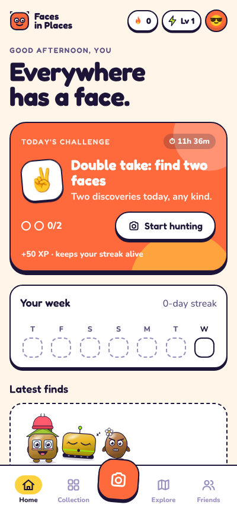
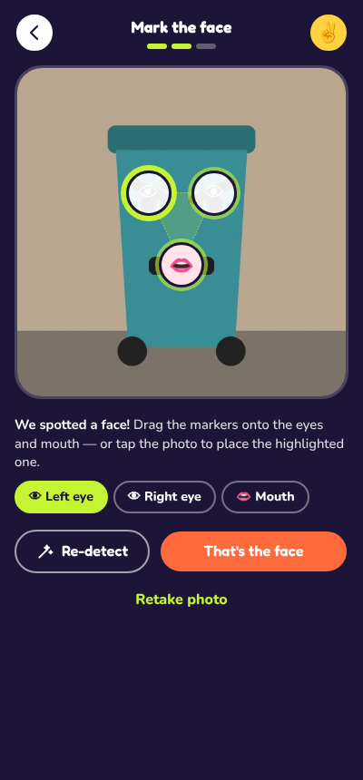
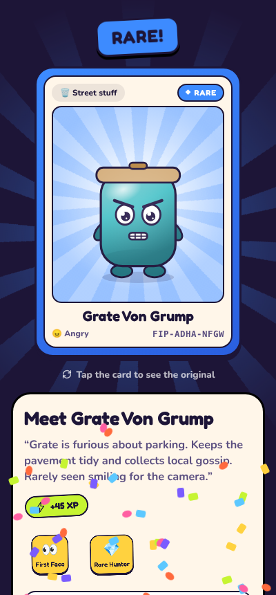
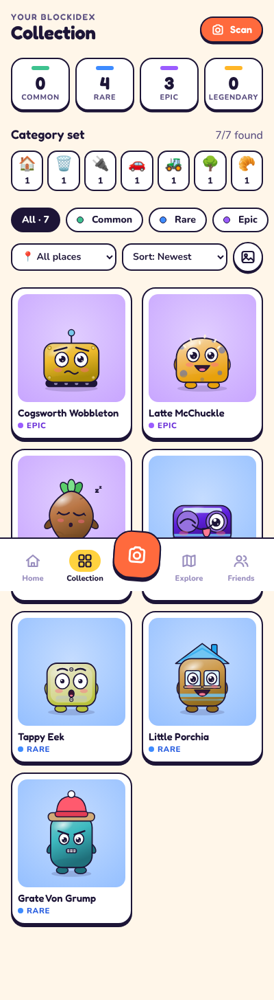
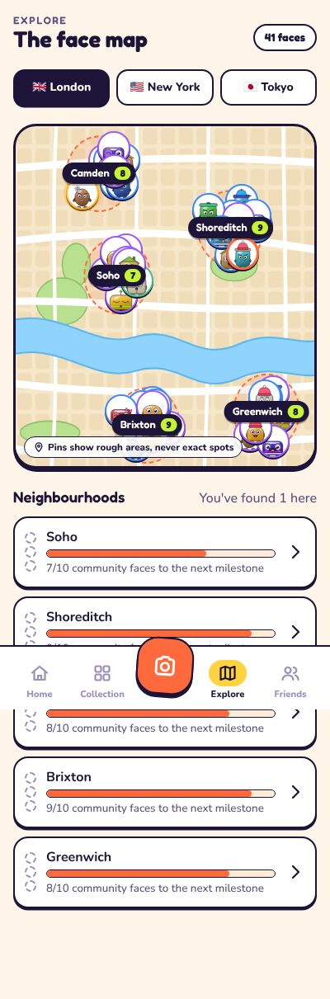
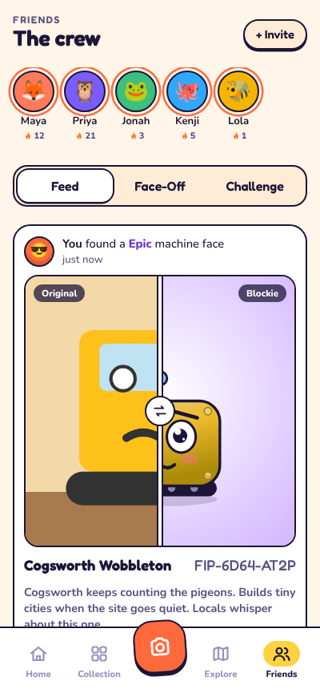

# Faces in Places

**Everywhere has a face.** A real-world discovery and collecting game: spot faces hidden in everyday objects, photograph them, and turn them into collectible characters called **Blockies**.

This folder is a working, mobile-first prototype of the MVP loop:

> Spot a face → Photograph it → Transform it → Collect it → Share it

| Home | Mark the face | Reveal | Collection | Map | Friends |
|---|---|---|---|---|---|
|  |  |  |  |  |  |

## Run it

You need a local server because the app uses ES modules:

```bash
cd faces-in-places
python3 -m http.server 4173     # or: npm start
```

Open http://localhost:4173 (best at phone width, or on your phone via your machine's LAN IP).
The live camera needs a secure context, which means `localhost` or HTTPS. Everywhere else, the **Upload** button and the phone's native camera still work, and the **sample photos** let you play on a laptop with no camera.

Tests (Node 18+, no dependencies):

```bash
npm test
```

## What's in the prototype

| Screen | What works |
|---|---|
| **Onboarding** | A 3-slide intro shown on first run (can be replayed from Profile). |
| **Home** | Today's challenge with a live countdown and progress, the 7-day streak strip, your latest finds, friends' finds and a Face-Off teaser. |
| **Scan** | Live camera (rear/front), photo upload, native phone camera, sample photos. Photos are centre-cropped to a square. |
| **Mark the face** | The app auto-detects a likely face; you drag (or tap-place, or nudge with arrow keys) markers for each eye and the mouth. |
| **Details** | Category, mood (pre-suggested), a live "counts for today's challenge" check, optional approximate location and sharing. |
| **Reveal** | Scanning animation with staged progress, a flash, then the card drops in and flips over. Rarity stamp and confetti scale with rarity. Shows XP, challenge completion, level-ups, new badges and a "Why Rare?" breakdown. Tap the card to see the original photo. |
| **Collection** | Rarity counters, the 7-category set, filters (rarity, category, neighbourhood), four sort orders, and a toggle between Blockies and original photos. |
| **Character profile** | Collectible card with 3D tilt and holo shine, Blockie/original flip, personality, facts, rarity reasons, accessories that unlock by level, rename, map sharing, release, and a share-card PNG export. |
| **Explore map** | Stylised maps of London, New York and Tokyo with Blockie pins scattered around each neighbourhood, neighbourhood milestones, a hidden local legend and top spotters. |
| **Friends** | Feed with a before/after slider (photo ↔ Blockie) and reactions, Face-Off voting, a daily challenge leaderboard, side-by-side collection comparison and a trade teaser. |
| **Profile** | Level ring, XP, streaks, stats, 11 badges, per-category progress, a Blockies+ teaser, and avatar/name/colour editing. |

Everything persists in `localStorage` on the device. Friends and community discoveries come from deterministic seed data (`js/data/seed.js`).

## How a Blockie is made

1. **Analyse** (`js/core/analysis.js`): the photo is reduced to 64×64 and summarised: dominant colours (weighted towards the centre, where the object usually is), brightness, contrast, saturation, detail level and a perceptual hash. `suggestFace` guesses the eyes and mouth from dark regions.
2. **Traits** (`js/core/traits.js`): photo colours become toy-friendly colours. The player's face marks set the eye spacing, mouth position and head tilt, and the category picks a body archetype.
3. **Render** (`js/render/blockie.js`): a procedural SVG in one consistent style. It has a chunky rounded vinyl-toy body, an ink outline, big eyes and a mouth driven by mood, plus a category signature: a roof for buildings, wheels and headlights for vehicles, a lid for street furniture, a faceplate for household objects, an antenna and tracks for machines, leaves for nature, seeds for food.
4. **Rarity** (`js/core/rarity.js`): rarity is earned by rules, not dice. Points come from category difficulty, vivid colours, multiple colours, contrast, detail, face symmetry, uncommon expressions and matching the daily challenge. The thresholds are Common 0–3, Rare 4–6, Epic 7–9 and Legendary 10+. Every card lists its reasons.
5. **Identity** (`js/core/naming.js`, `js/core/random.js`): a name, a personality and a `FIP-XXXX-XXXX` collectible ID. The same photo and face always produce the same Blockie.

### Plugging in a real image model

The UI only calls `generator.transform(request)` (see `js/ai/generator.js`). The default `MockGenerator` runs everything on the device. To use a real image-generation backend, set this in `index.html`:

```html
<script>
  window.FIP_CONFIG = { generator: "http", endpoint: "https://your-api.example/blockies", apiKey: "optional" };
</script>
```

`HttpGenerator` sends a POST request with `{ photo, face, category, mood, palette, style }` and expects `{ imageUrl, name?, personality? }` back. The returned image becomes the Blockie's art. Rarity, IDs and progression stay rule-based in the client so the game stays fair whichever model draws the art. In production, put the API key behind your own server rather than in the page.

## Privacy

- Location is opt-in. A device position is rounded to about 1 km and then snapped to a named neighbourhood. Only the neighbourhood is stored, never coordinates.
- Map pins are scattered at a fixed random offset around the neighbourhood centre, never at the real spot.
- Photos stay on the device (as roughly 40 KB JPEGs in `localStorage`) unless you export a share card.

## Project layout

```
index.html            app shell + tab bar
css/app.css           brand system and all screen styles
js/app.js             hash router
js/store.js           player state, XP/streak/challenge rules, persistence
js/ui.js              icons, cards, sheets, toasts, confetti, share-card export
js/ai/generator.js    Mock + HTTP character generators (swap point)
js/core/*             pure game logic (analysis, traits, rarity, naming, challenges, progression)
js/render/*           Blockie SVG renderer + illustrated sample scenes
js/data/*             cities/neighbourhoods and seeded friends/community
js/screens/*          one module per screen
tests/                node:test unit tests for the core logic
```

## Not built yet (by design)

Real accounts and backend sync, trading, AR, physical merch ordering, and the Blockies+ subscription. Their entry points ("Soon" buttons) are in place but stubbed. The proposed prices are placeholders, not validated assumptions.
